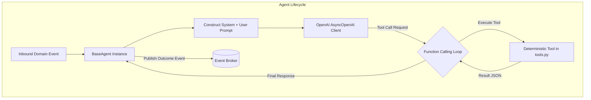

# Warehouse Agent Swarm - Agent Architecture & Implementations

## 1. Agent Design with the OpenAI SDK

Every agent in the warehouse swarm subclasses `BaseAgent` (`src/agents/base_agent.py`), which bridges the **OpenAI Chat Completions API** with the **EventBus** and our deterministic **Tool Layer**.

### Key Capabilities of `BaseAgent`
1. **OpenAI Tool Schemas**: Tools are registered with their JSON schema parameters (`type: "function"`), enabling the model to decide when and how to invoke functions.
2. **Multi-turn Function-Calling Loop**: Handles iterative reasoning—the model can call a verification tool, inspect its response, and then call a registration or quarantine tool.
3. **Dual Execution Modes**:
   - **Live LLM Mode**: When an `OPENAI_API_KEY` is provided, executes live calls against models like `gpt-4o-mini`.
   - **Deterministic Fallback (`mock_mode`)**: When running in automated test suites or offline environments without an API key, delegates to `mock_reasoning()` ensuring 100% reliable simulation runs.
4. **Decoupled Event Handling**: Subscribes to AMQP topic patterns via the `EventBus` and publishes domain events with correlation IDs.

---

## 2. Implemented Agents

### Agent 1: `ReceivingAgent` (`src/agents/receiving_agent.py`)

* **Domain**: Inbound freight processing at receiving docks.
* **Subscribed Topic**: `warehouse.inbound.shipment_arrived`
* **Emitted Events**:
  * `warehouse.inbound.pallet_received`
  * `warehouse.inbound.pallet_quarantined`
* **Registered OpenAI Tools**:
  * `verify_asn(asn_id)`: Checks the arriving delivery against expected vendor manifests.
  * `register_inbound_pallet(sku, quantity, weight_kg, dock_id)`: Registers accepted cargo into dock inventory and generates tracking IDs.
  * `quarantine_pallet(pallet_id, reason)`: Isolates damaged or non-conforming items to `QUARANTINE-BAY`.
* **Reasoning Flow**:
  1. Inspects arriving shipment payload.
  2. Verifies the ASN against expected manifest entries.
  3. Evaluates condition: intact pallets are registered at `DOCK-1`, while damaged pallets are quarantined.
  4. Emits domain events to signal the next agent in the choreography (the `PutawayAgent`).

---

### Agent 2: `PutawayAgent` (`src/agents/putaway_agent.py`)

* **Domain**: Storage slotting and rack reservation.
* **Subscribed Topic**: `warehouse.inbound.pallet_received`
* **Emitted Events**:
  * `warehouse.transport.requested` (`EventType.PUTAWAY_REQUESTED`)
* **Registered OpenAI Tools**:
  * `find_candidate_bins(weight_kg, preferred_zone)`: Identifies unoccupied, unblocked bins with sufficient weight capacity, prioritizing velocity zones.
  * `reserve_bin_for_putaway(bin_id, pallet_id)`: Atomically locks an empty bin to `RESERVED_PUTAWAY`.
  * `release_bin_reservation(bin_id)`: Rollback tool to release reservations if cancelled.
* **Reasoning Flow**:
  1. Receives notification of a pallet waiting at an inbound receiving dock.
  2. Evaluates weight and velocity heuristics to pick a preferred storage zone (Zone A for light/fast turnover, Zone B for medium, Zone C for heavy cargo).
  3. Calls `find_candidate_bins`, automatically detouring around blocked aisles/zones.
  4. Locks the optimal bin atomically with `reserve_bin_for_putaway`.
  5. Emits `warehouse.transport.requested` to dispatch the AGV / Fleet Transport Agent.

---

### Agent 3: `TransportAgent` (`src/agents/transport_agent.py`)

* **Domain**: Autonomous vehicle (AGV, AMR, Forklift) fleet dispatching.
* **Subscribed Topic**: `warehouse.transport.requested`
* **Emitted Events**:
  * `warehouse.transport.completed` (`EventType.TRANSPORT_COMPLETED`)
* **Registered OpenAI Tools**:
  * `query_available_vehicles(min_capacity_kg)`: Filters idle vehicles with battery $\ge 20\%$ and adequate payload capacity.
  * `dispatch_transport_mission(pallet_id, source, destination, preferred_vehicle_id)`: Binds the vehicle, transitions its state to `BUSY`, and creates an active mission.
  * `complete_transport_mission(mission_id)`: Updates physical locations, updates rack bin occupancy to `OCCUPIED`, reduces battery level, frees the vehicle back to `IDLE`, and writes to the ledger.
* **Reasoning Flow**:
  1. Receives a transport mission request (source, destination, pallet weight).
  2. Queries vehicle fleet for available units with sufficient payload rating (e.g. AGV for $\le 800$ kg, Forklift for heavy cargo).
  3. Dispatches the mission via `dispatch_transport_mission`.
  4. Once transit concludes, signals completion via `complete_transport_mission`.
  5. Emits `warehouse.transport.completed` to notify the `InventoryAgent` and order fulfillment processes.

---

### Agent 4: `InventoryAgent` (`src/agents/inventory_agent.py`)

* **Domain**: Real-time stock auditability, cycle counting, and ledger verification.
* **Subscribed Topics**:
  * `warehouse.transport.completed`
  * `warehouse.outbound.order_dispatched`
  * `warehouse.inventory.audit_requested`
* **Emitted Events**:
  * `warehouse.inventory.replenishment_alert` (`EventType.INVENTORY_MISMATCH`)
* **Registered OpenAI Tools**:
  * `get_inventory_summary(sku)`: Summarizes total and available quantities across all physical bins and docks.
  * `audit_ledger_history(limit)`: Retrieves recent chronological ledger transactions to verify consistency.
* **Reasoning Flow**:
  1. Triggered on transport arrivals, order dispatches, or cycle count requests.
  2. Inspects physical inventory quantities and cross-references recent ledger activity.
  3. Evaluates available units against safety replenishment thresholds.
  4. Publishes a replenishment alert if stock falls below the threshold.

---

### Agent 5: `OrderFulfillmentAgent` (`src/agents/order_fulfillment_agent.py`)

* **Domain**: Outbound customer order processing, inventory allocation, and pick dispatch.
* **Subscribed Topics**:
  * `warehouse.outbound.order_submitted`
  * `warehouse.transport.completed`
* **Emitted Events**:
  * `warehouse.transport.requested` (`EventType.PICK_DISPATCHED`)
  * `warehouse.outbound.order_dispatched` (`EventType.ORDER_DISPATCHED`)
* **Registered OpenAI Tools**:
  * `check_and_reserve_stock(sku, quantity, order_id)`: Atomically reserves stock from occupied bins and transitions bins to `RESERVED_PICK`.
  * `pack_and_dispatch_order(order_id, dispatch_dock)`: Reconciles allocations, decrements pallet quantities, and marks items as dispatched.
* **Reasoning Flow**:
  1. Ingests customer order with SKU and requested quantity.
  2. Atomically reserves stock via `check_and_reserve_stock` to prevent double-allocation.
  3. Dispatches AGV pick transport from the storage bin to `PACKING-BAY-1`.
  4. When the AGV arrives at the packing bay, executes `pack_and_dispatch_order`.
  5. Emits `warehouse.outbound.order_dispatched`.

---

### Agent 6: `ExceptionAgent` (`src/agents/exception_agent.py`)

* **Domain**: Physical anomaly mitigation, aisle containment, and safety management.
* **Subscribed Topics**:
  * `warehouse.exception.obstacle_reported`
  * `warehouse.exception.obstacle_cleared`
  * `warehouse.inbound.pallet_quarantined`
* **Emitted Events**:
  * `warehouse.corridor.blocked` (`EventType.CORRIDOR_BLOCKED`)
  * `warehouse.corridor.unblocked` (`EventType.CORRIDOR_UNBLOCKED`)
* **Registered OpenAI Tools**:
  * `block_corridor_zone(zone_id, reason)`: Cordon off a zone, forcing slotting and transport agents to detour.
  * `unblock_corridor_zone(zone_id)`: Restores access once maintenance clears the corridor.
* **Reasoning Flow**:
  1. Catches sensor/AGV obstacle or breakdown reports.
  2. Locks the corridor zone with `block_corridor_zone`, immediately affecting candidate bin discovery for putaway.
  3. Catches clearance notifications from maintenance and restores traffic via `unblock_corridor_zone`.
  4. Logs quarantined damaged cargo into the incident log.
