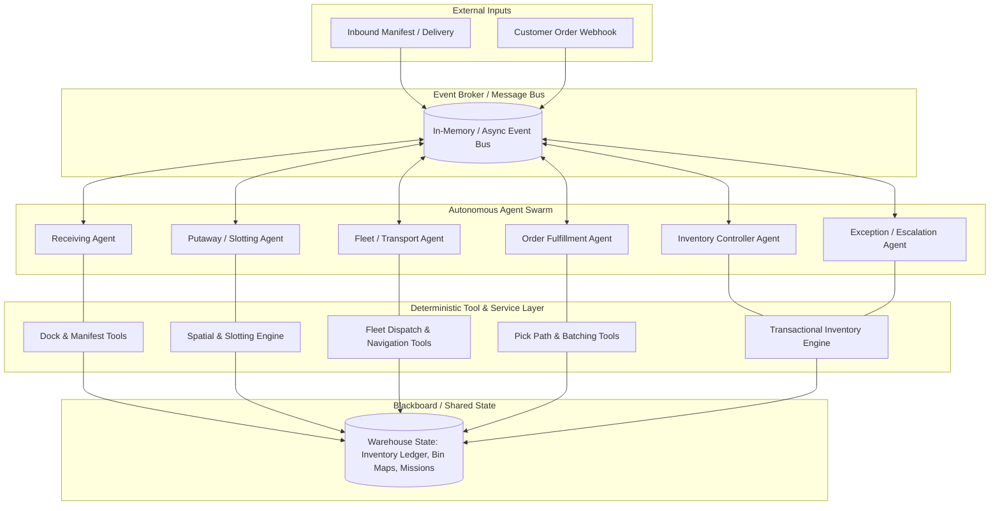
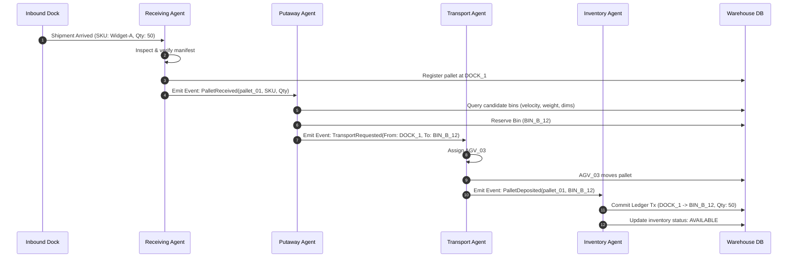
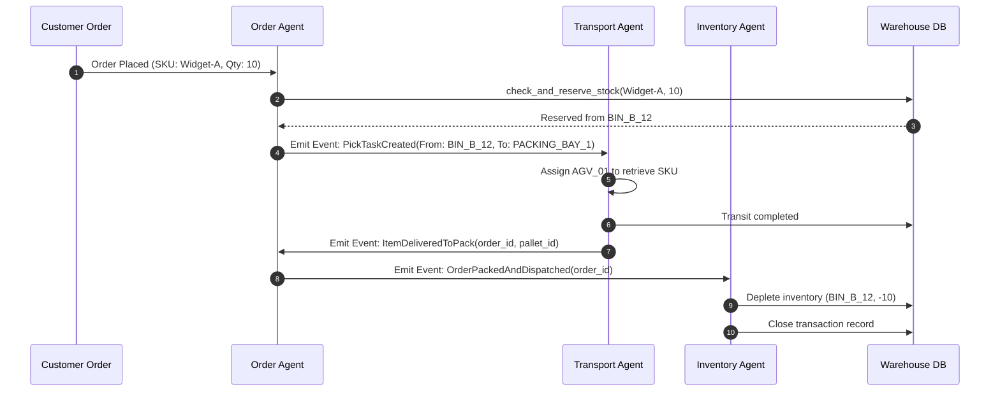
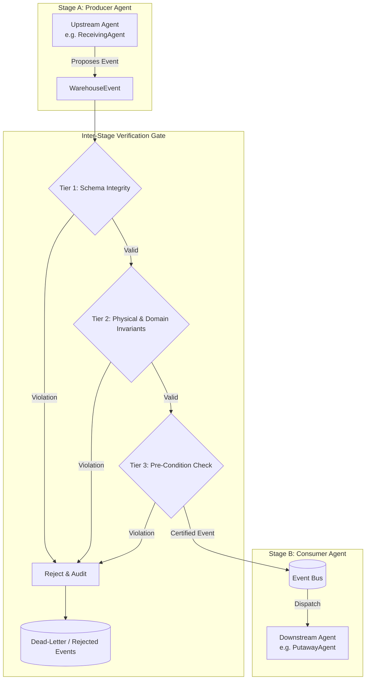

# Warehouse Agentic Swarm Architecture

## 1. Executive Summary & Problem Space

Modern automated logistics environments (warehouses, fulfillment centers) require high adaptability, distributed decision-making, and strict data consistency. Traditional Warehouse Management Systems (WMS) and Warehouse Execution Systems (WES) rely on rigid rule-based engines that struggle with dynamic disruptions (e.g., dock congestion, unexpected physical damages, dynamic slot recalculations, routing detours).

This project models and mocks an **Agentic Swarm Architecture** tailored for autonomous warehouse operations:
- **Inbound Processing**: Goods arrival, verification, inspection, and receiving.
- **Storage & Putaway**: Dynamic slot allocation based on physical properties, velocity, and capacity.
- **Transport & Fleet Orchestration**: Autonomous mobile robot (AMR) / AGV task dispatch and corridor traffic handling.
- **Outbound Fulfillment**: Order batching, inventory reservation, pick planning, and packing.
- **Inventory Ledger Consistency**: Continuous real-time auditability, stock reservation, and cycle counts.

---

## 2. Motivations: Why Use Agents over Traditional Deterministic Code?

A central question in agentic engineering is: *If deterministic business logic can run inside automated scripts or rule engines, why introduce LLM-based autonomous agents?*

The rule of thumb: **If a problem is strictly bounded, predictable, and fully standardized, deterministic code is superior**—it is faster, cheaper, and cannot hallucinate. Agents become essential when reality diverges from rigid, pre-programmed assumptions.

### 2.1 Where Traditional Automation Fails (The "Brittle Rule" Problem)

In a pure mock simulation, inputs are pristine: ASN manifests arrive as typed dictionaries, damages are clean enums, and orders follow strict JSON schemas. In real logistics operations, real-world inputs are messy:

| Operational Scenario | Traditional Deterministic Code | Agentic Swarm System |
| :--- | :--- | :--- |
| **Vendor Inbound Manifests (ASNs)** | Requires bespoke EDI parsers for every vendor's CSV, PDF, or email format. Any schema tweak causes pipeline ingestion failure. | Ingests semi-structured text, OCR scan summaries, driver notes, and PDF bills of lading without deploying new code per supplier. |
| **Damage & QA Assessment** | Binary check (`is_damaged: bool`). Incapable of reasoning about nuanced partial acceptance. | Understands human inspection notes or vision descriptions: *"Shrinkwrap torn on corner, 2 top cartons crushed, bottom 4 tiers intact"*. The agent decides: *quarantine top cartons, accept bottom tiers into inventory*. |
| **Complex Order Fulfillment Requests** | Rejects requests outside predefined schema constraints. | Interprets natural customer instructions: *"Urgent: if bulk pallet unavailable, split shipment, courier 5 units today, send balance via ground"*. Formulates a multi-step tool execution plan dynamically. |
| **Disruption Triage & Exception Recovery** | Throws unhandled exceptions or stalls workflows into a manual review queue when an expected bin is locked or stock is short by 2 units. | Reasons over contextual trade-offs: identifies alternate staging bays, proposes SKU substitutions, or reschedules transit around blocked corridors without waiting for human intervention. |
| **Human-in-the-Loop Collaboration** | Operators must navigate complex menus, manual SQL overrides, or dispatch GUIs. | Supervisors communicate in natural language (*"Zone A is closed for emergency maintenance, re-route in-flight AGVs and freeze outbound picks from aisles 1-3"*); agents translate that intent into atomic tool calls across the fleet. |

### 2.2 The Division of Labor: Stochastic Cognition vs. Deterministic Invariants

The architecture maintains a strict boundary between agent reasoning and deterministic enforcement:

```
┌────────────────────────────────────────────────────────┐
│   Agent Layer (LLM / Stochastic Cognition)             │
│   - Unstructured inputs (notes, OCR, operator chat)    │
│   - Multi-variable trade-offs & dynamic prioritization │
│   - Exception negotiation & recovery planning          │
└──────────────────────────┬─────────────────────────────┘
                           │ Tool Calls (OpenAI Function Calling)
┌──────────────────────────▼─────────────────────────────┐
│   Tool & Database Layer (Deterministic Invariants)     │
│   - Physical constraints (payload <= max_weight_kg)    │
│   - Financial ledger (ACID transactions, atomicity)    │
│   - Spatial geometry & collision avoidance             │
└────────────────────────────────────────────────────────┘
```

- **Tools enforce the laws of physics and accounting**: An agent cannot hallucinate that an AGV with an 800 kg limit can lift 2,000 kg, because `dispatch_transport_mission` validates payloads deterministically.
- **Agents provide heuristic navigation**: The agent interprets unstructured reality, formulates intent, and invokes those deterministic tools in adaptive sequences.

---

## 3. Architectural Paradigm Evaluation & Reasoning

Designing multi-agent systems involves choosing between different coordination patterns. Below is the decision matrix that drove our architectural choices.

### 3.1 Topology Comparison

| Topology | Mechanics | Pros | Cons / Risks | Suitability for Warehouse |
| :--- | :--- | :--- | :--- | :--- |
| **Pure Hierarchical (Supervisor / Orchestrator)** | A central controller agent receives all events, decomposes tasks, calls child agents, and handles all state transitions. | - Deterministic flow.<br>- Easy auditability and tracing.<br>- Predictable sequence. | - Single point of failure.<br>- High context window bloat.<br>- Latency bottleneck under concurrent events. | Poor for real-time edge operations; good for batch planning. |
| **Pure Choreography (Peer-to-Peer Swarm)** | Agents emit and consume events over a shared message bus without central authority; each agent reacts autonomously. | - Highly decoupled.<br>- Scalable.<br>- Resilient to individual agent downtime. | - Emergent behavior can cause deadlocks.<br>- Hard to trace complex multi-hop transactions.<br>- Risk of race conditions. | Good for fleet/transport, risky for inventory consistency. |
| **Blackboard Architecture** | Agents interact by reading from and writing to a globally accessible shared state repository. | - Shared source of truth.<br>- Decoupled observers.<br>- Easy introspection and state snapshotting. | - High contention on lockable state.<br>- Needs strict transaction primitives. | Excellent for inventory ledger and spatial layout. |
| **Hybrid (Choreographed Swarm + Blackboard State + Deterministic Tool Layer)** *(Selected)* | Event-driven triggers for workflow handoffs, backed by an atomic Blackboard database and deterministic tools enforcing invariants. | - Combines autonomy with strict financial/inventory consistency.<br>- Contexts remain compact.<br>- Isolated failures. | - Requires well-defined message schemas and schema validation. | **Optimal balance of autonomy and rigor.** |

### 3.2 Core Architectural Principles & Invariants

1. **Separation of Stochastic Cognition and Deterministic Invariants**:
   - **Agents** provide *heuristic reasoning*, *adaptation*, *plan decomposition*, and *exception triage*.
   - **Tools** enforce *atomic guarantees*, *spatial geometry calculations*, *schema validation*, and *ledger balances*.
   - *Rule*: An agent cannot directly mutate inventory by generating text; it must invoke an atomic, idempotent tool (e.g., `reserve_stock()`, `commit_transfer()`).

2. **Idempotency & Message Envelopes**:
   - Every event and tool invocation carries a globally unique `correlation_id` and `idempotency_key` to avoid duplicate processing during agent retries or network replays.

3. **Optimistic Locking over Pessimistic Blocking**:
   - Inventory items and storage bins use versioned records. If two picking agents attempt to reserve the same bin simultaneously, one succeeds and the other receives a conflict signal, prompting the agent to re-plan with an alternate bin.

---

## 4. System Architecture & Component Diagram



---

## 5. Agent Personas, Responsibilities & Toolsets

### 5.1 Inbound & Receiving Agent
* **Role**: First point of contact for supplier deliveries. Verifies shipping manifests (ASNs), inspects condition reports, logs discrepancies, and triggers putaway pipelines.
* **Key Decisions**:
  * Accept shipment, reject damaged lots, or quarantine items for secondary inspection.
* **Deterministic Tools**:
  * `verify_asn(asn_id: str) -> ASNManifest`
  * `register_pallet(sku: str, quantity: int, condition: str) -> PalletReceipt`
  * `quarantine_pallet(pallet_id: str, reason: str) -> QuarantineRecord`

### 5.2 Putaway / Slotting Agent
* **Role**: Computes the optimal storage location for incoming pallets based on item velocity (ABC analysis), dimensions, weight limits, temperature requirements, and current rack utilization.
* **Key Decisions**:
  * Select optimal bin (`Zone-Aisle-Rack-Shelf-Position`) to minimize future pick travel distance while respecting physical constraints.
* **Deterministic Tools**:
  * `find_candidate_bins(sku: str, weight_kg: float, dims: tuple) -> list[Bin]`
  * `reserve_bin(bin_id: str, pallet_id: str) -> bool`
  * `release_bin_reservation(bin_id: str) -> bool`

### 5.3 Fleet / Transport Agent (AGV Dispatcher)
* **Role**: Dispatches and monitors physical transport vehicles (forklifts, AGVs, AMRs) moving cargo across warehouse nodes (Dock $\to$ Storage Bin, Storage Bin $\to$ Packing Station).
* **Key Decisions**:
  * Assign mission to the closest available transport unit with sufficient payload capacity and battery level; reroute on blocked aisles.
* **Deterministic Tools**:
  * `query_available_vehicles() -> list[Vehicle]`
  * `dispatch_mission(vehicle_id: str, source: str, target: str, pallet_id: str) -> MissionID`
  * `report_mission_complete(mission_id: str) -> bool`
  * `report_obstacle(corridor_id: str) -> CorridorStatus`

### 5.4 Order Fulfillment & Picking Agent
* **Role**: Ingests customer orders, batches multi-line orders, reserves required stock against the inventory ledger, creates pick waves, and directs pickers/AGVs.
* **Key Decisions**:
  * Wave allocation strategy (single-order pick vs. batch cluster pick); handling partial availability.
* **Deterministic Tools**:
  * `check_and_reserve_stock(sku: str, quantity: int, order_id: str) -> list[Allocation]`
  * `generate_optimal_pick_path(bin_list: list[str]) -> list[Waypoint]`
  * `verify_pick_barcode(bin_id: str, sku: str, scanned_barcode: str) -> bool`

### 5.5 Inventory Controller Agent
* **Role**: Maintains ledger accuracy and guarantees consistent audit logs. Handles reconciliations, cycle-counting triggers, and low-stock replenishment alerts.
* **Key Decisions**:
  * Trigger inventory adjustments when physical counts deviate from ledger records; initiate restocking from suppliers.
* **Deterministic Tools**:
  * `execute_ledger_transaction(sku: str, from_loc: str, to_loc: str, qty: int, reason: str) -> TxReceipt`
  * `get_stock_balance(sku: str) -> StockSummary`
  * `reconcile_variance(bin_id: str, sku: str, expected: int, counted: int) -> VarianceLog`

### 5.6 Exception & Escalation Agent
* **Role**: Catches unrecoverable errors (e.g., stock missing at expected bin, AGV collision/breakdown, damaged pallet in storage) and initiates compensatory transactions or alerts human supervisors.
* **Key Decisions**:
  * Re-source missing SKU from alternative bin or split customer order; halt traffic in compromised zones.
* **Deterministic Tools**:
  * `halt_zone_traffic(zone_id: str) -> bool`
  * `cancel_reservation_and_backorder(order_id: str, sku: str) -> OrderUpdate`
  * `notify_human_operator(urgency: str, context: dict) -> AlertTicket`

---

## 6. End-to-End Workflow Lifecycles

### 6.1 Inbound Putaway Flow


### 5.2 Outbound Order & Picking Flow


---

## 7. Inter-Stage Verification, Guardrails & Anti-Hallucination Gates

In an autonomous multi-agent swarm, relying solely on downstream tools to catch hallucinations is reactive and risky. If an upstream agent emits an invalid event, that invalid data can trigger cascading agent wake-ups, unneeded planning cycles, or corrupted state.

To guarantee that agents behave correctly and cannot publish hallucinated or physically impossible parameters, the architecture enforces **Inter-Stage Verification Gates** directly between workflow stages at the broker boundary.



### 7.1 The Four Verification Tiers

1. **Tier 1: Strict Structural Schema Contracts**:
   - Every event published through `publish(topic, event)` is validated against typed data contracts (`WarehouseEvent`, `Pydantic` models). Missing correlation IDs, unrecognized event types, or malformed payloads are rejected immediately.

2. **Tier 2: Deterministic Domain & Physical Invariants (`EventValidator`)**:
   - The broker runs pluggable validator gates (`WarehouseDomainValidator`) before enqueuing events:
     - **Inbound Receipts**: Gross weight must be $> 0.0\text{ kg}$; quantity must be $> 0$; valid `pallet_id` required.
     - **Transport Missions**: Source and destination must exist, be distinct (`source != destination`), and specify a valid tracking ID.
     - **Outbound Orders**: Order quantities must be positive integers.
     - **Corridors & Safety**: Zone identifiers are restricted to recognized warehouse zones (`A`, `B`, `C`).

3. **Tier 3: State Pre-condition Interceptors**:
   - Validates that the physical assets referenced in the event exist in compatible states before notifying the next agent.
   - *Example*: A pick task cannot be dispatched for a bin currently marked `EMPTY` or `BLOCKED`.

4. **Tier 4: Actor-Critic & Critic / Evaluator Agents**:
   - For high-stakes, non-binary, or qualitative edge-cases (e.g. approving high-value cargo quarantine or hazardous material co-location), an independent **Critic Agent** evaluates the upstream agent's decision against standard operating procedures before the event is certified.

### 7.2 Containment & Auditing of Corrupted Events
When an event fails an inter-stage validator gate:
- It is **blocked** from reaching downstream agents, preventing cascading hallucinations.
- It is recorded in `InMemoryEventBus.rejected_events` with the offending topic, event envelope, and validator error message.
- A synthetic audit event is published to `warehouse.validation.rejected` for monitoring and supervisor alerting.

---

## 8. Concurrency, Race Conditions & Failure Modes

### 8.1 Concurrency Mitigations
1. **Double-Allocation Prevention**:
   - The ledger implements an atomic compare-and-swap (CAS) / transactional lock on stock reservations. If available count < requested count, the reservation fails gracefully and returns current alternative locations.
2. **Bin Deadlock Prevention**:
   - A single bin cannot be targeted by two concurrent putaway operations. Bins transition through discrete states: `EMPTY` $\to$ `RESERVED_PUTAWAY` $\to$ `OCCUPIED` $\to$ `RESERVED_PICK` $\to$ `EMPTY`.

### 8.2 Failure Handling & Compensation
- **Missing Stock at Bin**:
  - If a picker arrives and the physical item is absent, the picker emits `StockMismatchDetected`.
  - The `Exception Agent` locks the corrupted bin, initiates an inventory audit, and redirects the order to an alternate bin holding safety stock.
- **Transport Failure (AGV Breakdown)**:
  - If a transport task times out or AGV reports a breakdown, the `Fleet Agent` unassigns the AGV, re-queues the transport request for an alternate vehicle, and emits a maintenance warning.

---

## 9. Mock Implementation Blueprint & Code Layout

To simulate and test this architecture locally without external infrastructure dependencies, the code is organized into a modular structure under `src/`:

1. **`src/models.py`**: Data contracts for domain entities (`StorageBin`, `Pallet`, `TransportVehicle`, `TransportMission`, `StockAllocation`, `LedgerEntry`) and standard `WarehouseEvent` message envelopes.
2. **`src/database.py`**: Thread-safe transactional in-memory database (`WarehouseDatabase` / Blackboard) maintaining physical layouts, vehicle registries, bin occupancy, and the inventory ledger with reset and snapshot capabilities.
3. **`src/tools.py`**: Deterministic Python tool layer enforcing physical invariants, atomic reservation locks, and ledger transactions against `WarehouseDatabase`.
4. **`src/broker/`**: Pluggable publish/subscribe event exchange subsystem containing the abstract `EventBus` interface (`src/broker/base.py`) and the high-performance async in-memory broker (`src/broker/memory_bus.py`) supporting topic wildcards (`*`, `#`) and Dead-Letter Queues (DLQ).
5. **`src/agents/`**: Autonomous agent classes built with the OpenAI SDK function-calling loop, reaction handlers, tool invocation, and offline simulation fallback.
6. **`src/tests/`**: Unit and integration test suites (`unittest.IsolatedAsyncioTestCase`) validating broker routing, DLQ containment, and individual agent behaviors.
7. **`src/simulation.py`**: A scenario runner demonstrating concurrent inbound putaway, outbound order picking, and automated exception recovery.
