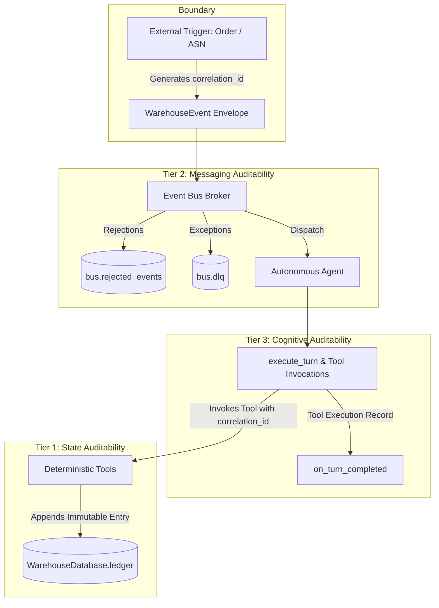
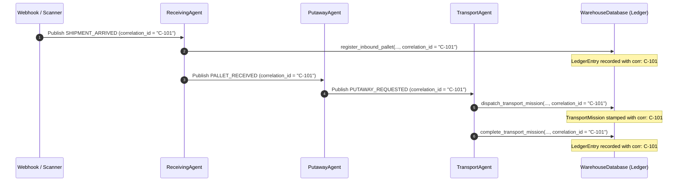

# Warehouse Agent Swarm - Auditability & Governance Architecture

## 1. Executive Summary & Audit Philosophy

In autonomous agentic architectures, **auditability is not a passive logging feature—it is a core governance invariant**. 

In traditional enterprise applications, audit logs record *what* data changed (`UPDATE users SET status = 'active'`). In an agentic swarm, where autonomous entities formulate plans, interpret unstructured instructions, and invoke tools without human intervention, auditing must answer three critical questions:
1. **What changed?** (State / Data Auditability)
2. **What communication triggered it?** (Messaging & Inter-Stage Auditability)
3. **Why did the agent decide to do it?** (Cognitive & Reasoning Auditability)



---

## 2. The Three Auditability Tiers

| Auditability Tier | Primary Mechanism | Location in Codebase | What It Audits |
| :--- | :--- | :--- | :--- |
| **Tier 1: State & Inventory** | Double-entry append-only ledger (`LedgerEntry`) | `src/database.py`, `src/tools.py` | Quantity movements, physical location transfers, reason codes, and causal correlation keys. |
| **Tier 2: Messaging & Guardrails** | Event bus history, validation gates, and Dead-Letter Queue (DLQ) | `src/broker/` | Topic dispatch logs, rejected hallucinated payloads, and consumer crash traces. |
| **Tier 3: Cognitive & Decision** | Agent turn lifecycle, tool call tracking, and attribution | `src/agents/base_agent.py` | Source agent attribution, executed tool arguments/results, and LLM reasoning steps. |

---

## 3. Tier 1: State & Inventory Auditability (The Ledger)

### 3.1 Immutable Ledger Contract
The warehouse inventory ledger (`WAREHOUSE_DB.ledger`) follows append-only, double-entry-style accounting principles. Inventory is **never mutated silently in place**. Every physical move (e.g. dock to rack, rack to packing bay) and administrative status change (quarantine, shipment depletion) requires a corresponding `LedgerEntry`:

```python
@dataclass
class LedgerEntry:
    transaction_id: str             # Unique UUID
    sku: str                        # Target item
    quantity: int                   # Quantity transferred
    source: str                     # From location
    destination: str                # To location
    reason: str                     # Business justification
    correlation_id: Optional[str]   # Causal trace key
    timestamp: datetime             # UTC timestamp
```

### 3.2 Double-Entry Movement Provenance
Physical inventory can be reconstructed at any historical point in time by replaying ledger transactions. For example, the lifecycle of cargo from a vendor truck to customer delivery follows this immutable trail:

```text
[16:08:57] [corr: 030a3af4-e028..] SKU-WIDGET-A (qty: 100) | SUPPLIER_TRUCK -> DOCK-1          | Inbound receipt pallet PLT-77A95C04
[16:08:57] [corr: 030a3af4-e028..] SKU-WIDGET-A (qty: 100) | DOCK-1         -> BIN-A-1-1-1     | Transport mission MSN-452558A8 completed
[16:08:57] [corr: 2bea01f5-23a7..] SKU-WIDGET-A (qty: 100) | BIN-A-1-1-1    -> PACKING-BAY-1   | Transport mission MSN-6359E3DE completed
[16:08:57] [corr: 2bea01f5-23a7..] SKU-WIDGET-A (qty:  30) | BIN-A-1-1-1    -> OUTBOUND-DOCK-1 | Order fulfillment: ORD-9901
[16:08:57] [corr: 2bea01f5-23a7..] SKU-WIDGET-A (qty:  70) | PACKING-BAY-1  -> BIN-A-1-1-1     | Transport mission MSN-1CC3E5F2 completed
```

---

## 4. Tier 2: Messaging & Inter-Stage Auditability

### 4.1 End-to-End Causal Tracing (`correlation_id`)
When a business operation enters the system (an inbound manifest scan or an ecommerce order submission), an immutable `correlation_id` (UUIDv4) is generated at the boundary.

This identifier is preserved across all asynchronous event hops and stamped directly onto operational and financial database entities:



**Auditing Benefit**: An auditor or incident investigator can query `audit_ledger_history()` filtered by `correlation_id` to replay the complete, multi-agent lifecycle of any pallet or order.

### 4.2 Guardrail & Hallucination Rejection Auditing
When an agent attempts to publish an event that violates physical or business rules (e.g. negative quantities, identical source/destination, or unrecognized warehouse zones), the event is intercepted by `WarehouseDomainValidator`:

1. **Rejection Logging**: The event is rejected before enqueueing and recorded in `InMemoryEventBus.rejected_events`:
   ```python
   (topic, event, "Invalid transport route: source and destination are identical ('DOCK-1').")
   ```
2. **Rejection Event Emission**: The broker emits an audit record to `warehouse.validation.rejected` containing:
   - `rejected_topic`: Target topic the agent attempted to publish to.
   - `original_payload`: The exact invalid payload proposed by the model.
   - `rejection_reason`: Deterministic validator failure message.
   - `validator`: Identifier of the validator gate (`WarehouseDomainValidator`).
   - `correlation_id`: Original causal key linking back to the activating task.

### 4.3 Dead-Letter Queue (DLQ) Auditing
If an event passes schema validation but a consumer handler raises an unhandled Python exception during execution, `_safe_invoke_handler` captures the incident into `InMemoryEventBus.dlq` (`DeadLetterEntry`):
- `topic`: Routing key.
- `event`: The unprocessed event envelope.
- `handler_name`: Fully qualified name of the failed callback.
- `error`: Complete exception message and stack trace.
- `timestamp`: UTC incident timestamp.

---

## 5. Tier 3: Cognitive & Reasoning Auditability

### 5.1 Agent Attribution
Every event envelope (`WarehouseEvent`) enforces source attribution:
- `source_agent`: The exact agent class that published the event (e.g., `ReceivingAgent`, `PutawayAgent`, `OrderFulfillmentAgent`).
- When calling `self.publish(topic, event)`, `BaseAgent` automatically populates `source_agent = self.name` if not already set, preventing unauthenticated anonymous emissions.

### 5.2 Tool Execution Tracking (`on_turn_completed`)
In live LLM mode (`mock_mode=False`), `BaseAgent.execute_turn` monitors and accumulates every tool call requested by the model:
```python
executed_tool_results.append({
    "tool_name": func_name,
    "arguments": args,
    "result": tool_result,
})
```
When the model concludes its reasoning turn, this full audit log is passed to `on_turn_completed()`, ensuring complete transparency into which deterministic tools were executed, what arguments were provided, and what outputs were returned.

---

## 6. Gap Analysis & Production Compliance Roadmap

While the mock architecture provides complete causal tracing and ledger invariants, deploying an agentic swarm into regulated enterprise environments (e.g., pharmaceutical logistics, aerospace parts, financial warehousing) requires addressing the following gaps:

| Capability | Current Status in Prototype | Production-Grade Requirement |
| :--- | :--- | :--- |
| **Ledger Storage** | Bounded in-memory circular buffer (`deque(maxlen=5000)`) | Append-only relational database (e.g., PostgreSQL with write-only roles or Amazon QLDB). |
| **Distributed Tracing** | Internal string `correlation_id` | W3C Trace Context / OpenTelemetry headers (`traceparent`, `tracestate`) across all HTTP/AMQP boundaries. |
| **Cognitive Trace Archival** | Ephemeral (held in memory during turn, discarded after completion) | Archival of full prompt, model version, temperature, completion tokens, and raw assistant messages in an observability store (e.g., Langfuse, Arize Phoenix, or Datadog LLM Observability). |
| **Cryptographic Authenticity** | `source_agent` string attribute | Digital signatures on message envelopes (HMAC/Ed25519) using per-agent private keys to guarantee non-repudiation. |
| **Alerting Integration** | Synthetic event `warehouse.validation.rejected` | Webhook alerting into incident response systems (PagerDuty, Slack, Opsgenie) for continuous DLQ monitoring. |
