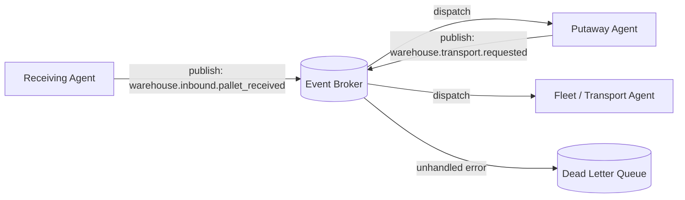

# Event Broker Architecture & Interface Documentation

## 1. Role in the Swarm Architecture

The event broker is the central nervous system of the warehouse swarm. Rather than agents maintaining hardcoded direct references to one another (which creates tight coupling and fragility), agents interact using **asynchronous publish/subscribe choreography**:

- An agent performs its bounded duty (e.g. receiving cargo) using deterministic tools.
- Upon completing an action, it publishes a structured event (e.g. `warehouse.inbound.pallet_received`) to the broker.
- Interested downstream agents (e.g. Putaway Agent) consume matching events, formulate plans, invoke tools, and emit their own follow-up events.



---

## 2. Directory Layout & Module Structure

The broker subsystem is isolated inside `src/broker/`:

```
src/broker/
├── __init__.py        # Clean package exports (EventBus, InMemoryEventBus, EventValidator, etc.)
├── base.py            # Abstract EventBus interface and EventHandler protocol
├── validator.py       # Inter-stage event validation gates and domain guardrails
└── memory_bus.py      # Production-grade In-Memory asyncio broker implementation
```

---

## 3. Abstract Interface: `EventBus` (`base.py`)

Any message transport layer (RabbitMQ, Kafka, Redis Streams, or In-Memory) implements this uniform interface:

```python
class EventBus(ABC):
    @abstractmethod
    def add_validator(self, validator: EventValidator) -> None:
        """Registers an inter-stage event validator gate."""
        pass

    @abstractmethod
    async def publish(self, topic: str, event: WarehouseEvent) -> None:
        """Publishes a WarehouseEvent to a specific dot-delimited topic key."""
        pass

    @abstractmethod
    async def subscribe(self, topic_pattern: str, handler: EventHandler) -> None:
        """Subscribes an async handler using exact topics or AMQP wildcards."""
        pass

    @abstractmethod
    async def start(self) -> None:
        """Starts worker loops and dispatch queues."""
        pass

    @abstractmethod
    async def stop(self) -> None:
        """Gracefully drains queues and shuts down workers."""
        pass
```

---

## 4. Implementation: `InMemoryEventBus` (`memory_bus.py`)

### 4.1 AMQP Topic Wildcard Matching
The in-memory broker compiles dot-delimited routing patterns into regular expressions matching standard AMQP/RabbitMQ routing conventions:

| Pattern | Example Subscription | Matches | Does Not Match |
| :--- | :--- | :--- | :--- |
| **Exact** | `warehouse.inbound.pallet_received` | `warehouse.inbound.pallet_received` | `warehouse.inbound.damaged` |
| **Single Word (`*`)** | `warehouse.inbound.*` | `warehouse.inbound.pallet_received`<br>`warehouse.inbound.shipment_docked` | `warehouse.inbound.pallet.damaged` |
| **Multi Word (`#`)** | `warehouse.transport.#` | `warehouse.transport.requested`<br>`warehouse.transport.mission.completed` | `warehouse.inbound.pallet_received` |

### 4.2 Error Containment & Dead-Letter Queue (DLQ)
If a consumer handler throws an unhandled exception, it is caught in `_safe_invoke_handler()`. The error is logged, and the event and trace are appended to `InMemoryEventBus.dlq` (`DeadLetterEntry`), preventing a failure in one agent from crashing the event loop or other concurrent consumers.

### 4.3 Inter-Stage Validator Gates (`validator.py`)
To prevent hallucinated, malformed, or physically impossible data from propagating from an upstream agent to downstream consumers, `publish()` executes registered `EventValidator` gates before events enter the dispatch queue:

- If all validators return `ValidationResult(is_valid=True)`, the event is enqueued normally.
- If any validator returns `ValidationResult(is_valid=False, error=...)`:
  - The event is **halted** and excluded from normal downstream routing.
  - The failure is appended to `InMemoryEventBus.rejected_events` for auditing.
  - A rejection event is enqueued on `warehouse.validation.rejected` for monitoring.

Default validation is provided by `WarehouseDomainValidator`:
- **Inbound Receipts**: Enforces non-empty `pallet_id`, `quantity > 0`, and `weight_kg > 0.0`.
- **Transport Routes**: Enforces non-empty `pallet_id`, distinct `source` and `destination` (`source != destination`).
- **Orders**: Enforces non-empty `order_id` and positive `quantity > 0`.
- **Corridors**: Enforces recognized zone codes (`A`, `B`, `C`).

### 4.4 Simulation Testing Utility
- `wait_until_idle()`: Awaits the underlying `asyncio.Queue.join()` so tests and simulations can cleanly block until all in-flight events are fully consumed before asserting state.

---

## 5. Swapping to a Distributed Broker (e.g. RabbitMQ)

Because agent classes only accept an instance of `EventBus`, dropping in RabbitMQ requires only creating `src/broker/rabbitmq_bus.py` wrapping `aio-pika`:

```python
# Conceptual RabbitMQ drop-in without touching agent code:
class RabbitMQEventBus(EventBus):
    def __init__(self, amqp_url: str):
        self.url = amqp_url
        # Connect to AMQP topic exchange...

    async def publish(self, topic: str, event: WarehouseEvent) -> None:
        # Publish to topic exchange with routing_key=topic

    async def subscribe(self, topic_pattern: str, handler: EventHandler) -> None:
        # Bind exclusive consumer queue to exchange with binding_key=topic_pattern
```
