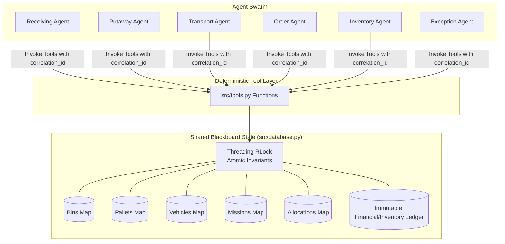
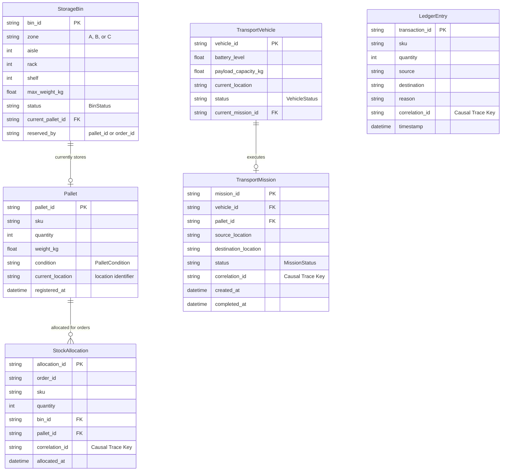

# Warehouse State Database (Blackboard) Documentation

## 1. Overview & Architectural Role

In this agentic swarm system, the database layer (`src/database.py`) acts as the **Blackboard / Shared State Digital Twin**. 

While autonomous agents communicate via asynchronous, choreographed domain events over the broker, they do not store persistent domain state internally. All ground-truth state—warehouse spatial layouts, physical pallet locations, vehicle availability, stock allocations, and immutable ledger transactions—resides in the central, thread-safe `WarehouseDatabase`.



---

## 2. Entity Relationship Model (ERD)



---

## 3. Entity Specifications & Field Dictionary

### 3.1 `StorageBin`
Represents physical racking locations across the warehouse grid.
- `bin_id` (*str, PK*): Formatted coordinate e.g. `BIN-A-1-2-1` (`BIN-{zone}-{aisle}-{rack}-{shelf}`).
- `zone` (*str*): Velocity/weight zone (`A`: fast/light $\le 500\text{kg}$, `B`: medium $\le 1000\text{kg}$, `C`: heavy $\le 2500\text{kg}$).
- `max_weight_kg` (*float*): Structural load rating enforced during candidate bin queries.
- `status` (*BinStatus enum*): State machine status (`EMPTY`, `RESERVED_PUTAWAY`, `OCCUPIED`, `RESERVED_PICK`, `BLOCKED`).
- `current_pallet_id` (*str, optional FK*): References the stored `Pallet`.
- `reserved_by` (*str, optional*): Identifies the reserving entity (`pallet_id` for putaway, `order_id` for picking).

### 3.2 `Pallet`
Represents a physical cargo unit tracked from inbound receiving dock to dispatch.
- `pallet_id` (*str, PK*): Unique tracking code (e.g. `PLT-77A95C04`).
- `sku` (*str*): Stock Keeping Unit identifier.
- `quantity` (*int*): Current on-pallet unit count.
- `weight_kg` (*float*): Gross weight validated against AGV capacity and bin structural limits.
- `condition` (*PalletCondition enum*): `INTACT`, `DAMAGED`, or `QUARANTINED`.
- `current_location` (*str*): Current node (`DOCK-1`, `BIN-A-1-1-1`, `PACKING-BAY-1`, `QUARANTINE-BAY`, `SHIPPED`).

### 3.3 `TransportVehicle`
Represents autonomous AGVs, AMRs, and Forklifts.
- `vehicle_id` (*str, PK*): e.g. `AGV-01`, `AGV-02`, `FORKLIFT-01`.
- `battery_level` (*float*): State of charge ($0.0\%$ to $100.0\%$). Decrements by $3.5\%$ per completed transport mission.
- `payload_capacity_kg` (*float*): Maximum cargo payload ($800\text{kg}$ for AGVs, $3000\text{kg}$ for Forklifts).
- `status` (*VehicleStatus enum*): `IDLE`, `BUSY`, `MAINTENANCE`, `CHARGING`.

### 3.4 `TransportMission`
Tracks active and completed vehicle transit movements between warehouse nodes.
- `mission_id` (*str, PK*): e.g. `MSN-452558A8`.
- `correlation_id` (*str, optional*): Foreign key linking the mission to the upstream triggering event.
- `status` (*str*): `ASSIGNED`, `IN_TRANSIT`, `COMPLETED`, `FAILED`.

### 3.5 `StockAllocation`
Represents atomic stock reservations locking quantities for customer orders before physical pick waves begin.
- `allocation_id` (*str, PK*): e.g. `ALC-B1C2D3E4`.
- `order_id` (*str*): Target customer order.
- `correlation_id` (*str, optional*): Event correlation key.

### 3.6 `LedgerEntry` (Double-Entry Audit Trail)
An append-only, immutable transaction log recording every quantity transfer across physical or administrative locations.
- `transaction_id` (*str, PK*): Unique transaction UUID.
- `sku` (*str*): Item transferred.
- `quantity` (*int*): Quantity moved.
- `source` (*str*): Originating location.
- `destination` (*str*): Receiving location.
- `reason` (*str*): Explanatory business justification (e.g., `"Inbound receipt"`, `"Order fulfillment"`, `"Quarantine"`).
- `correlation_id` (*str, optional*): **Causal Trace Key** linking the ledger movement to the activating business event.

---

## 4. Causal Tracing & Auditability

Every business workflow generates a single `correlation_id` at the boundary (e.g. `CORR-ORDER-9901` or arriving shipment scan). This correlation ID is propagated across all stages and stamped directly into the database records:

```text
[16:08:57] [corr: 2bea01f5-23a7..] SKU-WIDGET-A (qty: 100) | BIN-A-1-1-1   -> PACKING-BAY-1   | Transport mission MSN-6359E3DE completed
[16:08:57] [corr: 2bea01f5-23a7..] SKU-WIDGET-A (qty:  30) | BIN-A-1-1-1   -> OUTBOUND-DOCK-1 | Order fulfillment: ORD-9901
[16:08:57] [corr: 2bea01f5-23a7..] SKU-WIDGET-A (qty:  70) | PACKING-BAY-1 -> BIN-A-1-1-1     | Transport mission MSN-1CC3E5F2 completed
```

With this causal link:
- Auditors can query `audit_ledger_history()` by `correlation_id` to reconstruct the complete chronological timeline of an order or shipment.
- Exception handlers can inspect the exact sequence of state changes that occurred before a failure.

---

## 5. Concurrency Control & Invariants

1. **Re-entrant Mutex (`threading.RLock`)**:
   All state mutations and reads in `src/tools.py` occur inside `with WAREHOUSE_DB._lock:`, guaranteeing atomic compare-and-swap behavior across concurrent async event handlers.
2. **State Machine Transitions**:
   Bins and vehicles enforce strict status validation. A bin cannot be claimed for putaway unless it is strictly `EMPTY`, and an AGV cannot be dispatched unless it is strictly `IDLE` with battery $\ge 20\%$.
3. **Blackboard Reset for Testability**:
   `WAREHOUSE_DB.reset()` atomically flushes all pallets, allocations, missions, and ledger entries, and re-seeds standard bins and vehicles for repeatable simulation runs and isolated unit testing.
