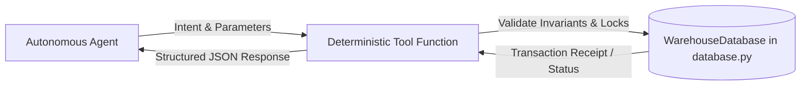
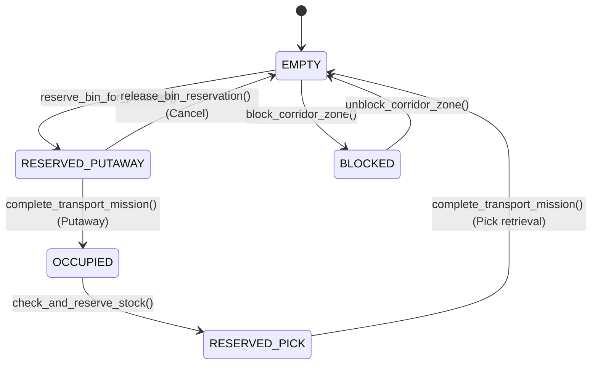

# Warehouse Swarm - Deterministic Tools Documentation

## 1. Overview & Architectural Role

In this agentic system, **tools form the deterministic invariant layer**. Agents are responsible for perception, reasoning, heuristic optimization, and exception handling, but they are strictly barred from directly modifying warehouse state through unvalidated code or free-form text.

Every state transition—whether reserving a rack shelf, moving a pallet across corridors, or decrementing inventory—must pass through atomic, idempotent, thread-safe tools backed by the **Warehouse Blackboard Database** (`WarehouseDatabase` in `database.py`).



---

## 2. Core Data Models & State Machine

Domain entities and event contracts are defined in `models.py` (`StorageBin`, `Pallet`, `TransportVehicle`, `TransportMission`, `StockAllocation`, `LedgerEntry`, and `WarehouseEvent`). The state repository is managed in `database.py` (`WarehouseDatabase`), and imported by `tools.py` for transactional operations.

### 2.1 Bin Lifecycle State Machine
Bins transition through explicit states to prevent race conditions (such as two putaway agents picking the same empty shelf or two pickers targeting the same pallet):



### 2.2 Vehicle Lifecycle States
- `IDLE`: Stationed at a dock, charging bay, or aisle; eligible for new missions if battery $\ge 20\%$.
- `BUSY`: Actively executing a mission (`IN_TRANSIT`).
- `CHARGING`: Below operating threshold.
- `MAINTENANCE`: Withdrawn from service due to breakdown or obstacle.

---

## 3. Tool Reference

The tools are organized into 6 functional groups matching the warehouse workflow domains.

### Group 1: Inbound & Receiving Tools

| Function | Parameters | Return Schema | Invariants Enforced |
| :--- | :--- | :--- | :--- |
| `verify_asn` | `asn_id: str` | `{"valid": bool, "expected_skus": dict, "error": str?}` | Ensures arriving delivery matches registered Advance Shipping Notices before unloading starts. |
| `register_inbound_pallet` | `sku: str`<br>`quantity: int`<br>`weight_kg: float`<br>`dock_id: str = "DOCK-1"`<br>`condition: PalletCondition` | `{"success": bool, "pallet_id": str, "sku": str, "quantity": int, ...}` | Generates unique tracking ID (`PLT-XXXXXXXX`), places pallet at dock, and registers an initial ledger receipt. |
| `quarantine_pallet` | `pallet_id: str`<br>`reason: str` | `{"success": bool, "pallet_id": str, "status": "QUARANTINED", ...}` | Transitions pallet status to `QUARANTINED`, moves location to `QUARANTINE-BAY`, and appends an audit event. |

---

### Group 2: Putaway & Slotting Tools

| Function | Parameters | Return Schema | Invariants Enforced |
| :--- | :--- | :--- | :--- |
| `find_candidate_bins` | `weight_kg: float`<br>`preferred_zone: str?` | `list[{"bin_id": str, "zone": str, "score": int, ...}]` | Filters for bins that are strictly `EMPTY`, not inside blocked zones, and where `max_weight_kg >= weight_kg`. Prioritizes zone affinity and shelf height. |
| `reserve_bin_for_putaway` | `bin_id: str`<br>`pallet_id: str` | `{"success": bool, "bin_id": str, "reserved_for": str}` | Atomically locks bin from `EMPTY` to `RESERVED_PUTAWAY`. Rejects if already reserved or occupied. |
| `release_bin_reservation` | `bin_id: str` | `{"success": bool, "bin_id": str, "status": "RELEASED"}` | Rollback tool; releases a reserved bin back to `EMPTY` if an inbound job is diverted or cancelled. |

---

### Group 3: Fleet & Transport Tools

| Function | Parameters | Return Schema | Invariants Enforced |
| :--- | :--- | :--- | :--- |
| `query_available_vehicles` | `min_capacity_kg: float = 0.0` | `list[{"vehicle_id": str, "battery_level": float, "capacity_kg": float, ...}]` | Only returns vehicles with status `IDLE`, battery $\ge 20\%$, and sufficient payload capacity. |
| `dispatch_transport_mission` | `pallet_id: str`<br>`source: str`<br>`destination: str`<br>`preferred_vehicle_id: str?` | `{"success": bool, "mission_id": str, "vehicle_id": str, ...}` | Matches vehicle capacity to pallet weight, sets vehicle to `BUSY`, registers mission with status `IN_TRANSIT`. |
| `complete_transport_mission` | `mission_id: str` | `{"success": bool, "mission_id": str, "pallet_id": str, "new_location": str, ...}` | Updates pallet position, resets vehicle to `IDLE`, docks battery level $(-3.5\%)$, updates target bin to `OCCUPIED` (or frees source bin), and appends to the ledger. |

---

### Group 4: Outbound Order & Picking Tools

| Function | Parameters | Return Schema | Invariants Enforced |
| :--- | :--- | :--- | :--- |
| `check_and_reserve_stock` | `sku: str`<br>`quantity: int`<br>`order_id: str` | `{"success": bool, "total_reserved": int, "allocations": list}` | Verifies available undamaged stock across occupied bins. Allocates pallets, transitions bins to `RESERVED_PICK`, and prevents double-allocation. |
| `pack_and_dispatch_order` | `order_id: str`<br>`dispatch_dock: str = "OUTBOUND-DOCK-1"` | `{"success": bool, "order_id": str, "items": list, "status": "DISPATCHED"}` | Reconciles allocated stock against the order, decrements pallet quantities, marks fully picked pallets as `SHIPPED`, and records dispatch ledger entries. |

---

### Group 5: Inventory & Audit Tools

| Function | Parameters | Return Schema | Invariants Enforced |
| :--- | :--- | :--- | :--- |
| `get_inventory_summary` | `sku: str? = None` | `{"inventory": dict, "timestamp": str}` | Aggregates physical stock counts across all bins and docks, differentiating available vs. quarantined quantities. |
| `audit_ledger_history` | `limit: int = 20` | `list[{"tx_id": str, "sku": str, "qty": int, "from": str, "to": str, ...}]` | Chronological immutable log of all physical and administrative item transfers. |

---

### Group 6: Exception & Anomaly Handling Tools

| Function | Parameters | Return Schema | Invariants Enforced |
| :--- | :--- | :--- | :--- |
| `block_corridor_zone` | `zone_id: str`<br>`reason: str` | `{"success": bool, "blocked_zone": str, "active_blocked_zones": list}` | Adds zone to `blocked_zones`. Bins in this zone are automatically excluded from putaway candidate scans. |
| `unblock_corridor_zone` | `zone_id: str` | `{"success": bool, "unblocked_zone": str}` | Restores access to a cleared corridor/zone. |

---

## 4. Usage Example in Agent Loops

Here is how an agent reasoning cycle leverages these tools:

```python
from tools import (
    find_candidate_bins,
    reserve_bin_for_putaway,
    dispatch_transport_mission,
    complete_transport_mission,
)

# 1. Agent asks tool for candidates matching constraints
candidates = find_candidate_bins(weight_kg=350.0, preferred_zone="A")
chosen_bin = candidates[0]["bin_id"]

# 2. Agent locks the chosen bin
res = reserve_bin_for_putaway(bin_id=chosen_bin, pallet_id="PLT-A1B2C3D4")
if res["success"]:
    # 3. Agent dispatches an AGV
    mission = dispatch_transport_mission(
        pallet_id="PLT-A1B2C3D4",
        source="DOCK-1",
        destination=chosen_bin,
    )
    # 4. On transport arrival callback/event:
    complete_transport_mission(mission_id=mission["mission_id"])
```
